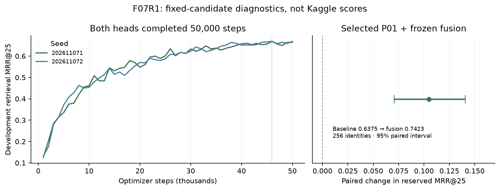

# P14: complementary frozen-feature channel

The second user-approved trial uses the completed F07R1 experiment as a new
final-list neural channel on the verified P01 pipeline. P13 is a separate
outsider-blend trial; its change is not included. P01 remains the champion until
an actual submitted score exceeds0.480.

## Completed training and selection

F07R1 finished at2026-11-07T23:22:08UTC (18:22 Eastern), within its original
24-hour cap. Both seeds completed50,000 steps; zero supervised restarts.
Peak reserved VRAM was3.223GiB. Development-only checkpoint selection chose
step46,000 for both seeds.

| Seed | Development retrieval MRR@25 | Reserved retrieval MRR@25 |
|---|---|---|
| 202611071 (pilot warmup) | 0.668168 | 0.643146 |
| 202611072 (full population from start) | 0.668772 | 0.665608 |

These are truth-forced,256-candidate, mass-near diagnostics, not candidate recall
or end-to-end MRR. The heads exclude held-out identity/input groups; encoder
pretraining overlap is not audited. The deployed head is an80%-fold fit rather
than a full-data refit.

`qualify_frozen_fusion.py` scores the same fresh512 identities/acquisitions with
the exact original and v80 P01 checkpoints. It selects among two individual
heads and their equal standardized blend, with new-channel weights0.1/0.2/0.35/0.5,
using development labels only. It writes the selection before the reserved
comparison. The selected combination is **seed202611071, weight0.5**; it is
chosen for complementarity to P01, not its standalone confirmation score.

| Fixed-candidate comparison | P01 baseline | P14 blend | Paired change | 95% paired interval |
|---|---|---|---|---|
| Development,256 identities | 0.627718 | 0.759511 | +0.131793 | [0.093026,0.170712] |
| Reserved,256 identities | 0.637481 | 0.742269 | +0.104787 | [0.070643,0.140729] |

Reserved cases:92 improve,23 worsen. This supports an experimental trial, not
a predicted Kaggle score. The candidate lists force the truth to be present;
the baseline checkpoint fits are not newly refit to exclude these identities;
and the physical/final candidate generator is absent from this diagnostic.
Absolute comparisons with L06 or Kaggle MRR are invalid.

## Production behavior

- Preserve P01's exact original/v80 blend, outsider scorer, library/physical
  logic, priors and metric-identity deduplication. The original checkpoints are
  byte-pinned. Save the original final-list neural scores as`neural_p01.parquet`.
- Apply the new channel to supported positive single-charge spectra only,
  with precursor<=1000Th and at least3 retained peaks. Remove nonfinite,
  nonpositive and above1000Th fragment peaks before top100 selection and
  intensity normalization. Prepend the1.1-intensity precursor token exactly as
  in training. Keep cached encoder features inFLOAT16 before feeding the head.
- Average projected query vectors over supported observed acquisitions. Score
  the existing final-list candidates; no truth, formula or extra candidate is
  injected. Use the original frozen molecular cache for known2D identities and
  the pinned IBM encoder/tokenizer for new structures.
- Normalize the new score within each query, then combine it50:50 with P01
  while preserving P01's score location/scale. Auxiliary cosine/fingerprint/
  dispersion columns remain unchanged. A query is fused only if every candidate
  has a valid new score. Unsupported or unavailable-input groups keep P01 exactly.
- Unexpected execution/checksum errors propagate and remove`submission.csv`,
  avoiding an accidental old-baseline submission. Known input failures retain
  baseline and are counted. The smoke must use real supported inputs with zero
  input errors; hidden datasets are not forced to match smoke row counts.

## Offline inference package and checks

Private dataset:`clarkkitchen/casmi26-frozen-p14-20261107`, version1,
approximately0.947GiB. Manifest SHA256:
`22c5300c20a942fdd346aa26ca5f57237664e6a251e4c48ba18daaace16eac19`.
Selected checkpoint SHA256:
`81d117d0e81698ae46a4f3b0077c329c8710aae555bdba6331955c4fbe896350`.

`export_frozen_encoders.py` turns the verified original encoders into inference
graphs. It does not train a teacher/student approximation. One aliased registered
parameter is cloned with identical values because JIT rejects parameter sharing;
original outputs remain exactly equal. DreaMS graph parity error is0.0 on tested
batch sizes1/3/8/13. MoLFormer maximum error is9.54e-7, and fixed202-token padding
differs from variable padding by at most1.43e-6 on the checked examples. Weights
and graph computation useFLOAT32; cached representation storage usesFLOAT16.
The package retains upstream licenses/model card and exact source revisions.

Independent checks on64 raw competition spectra match the immutable R1 input
arrays exactly. Rust inference token IDs/masks match the original HF tokenizer
on64 molecules. Five edge/invariance tests cover out-of-range base peaks,
unsupported queries, minimum peak count and score scale.

The local real12 Kaggle-query smoke scored11 supported queries, used120 known
and155 new structures, preserved one unsupported query, and had zero input
errors. The mandatory Kaggle smoke tests the exported graphs in the actual
pinned image before the public pipeline starts, then runs12 real molecules
through the complete pipeline. It must independently pass fusion/fallback,
checkpoint,400-row schema and official-identity deduplication checks before
the final approved scoring submission is spent.

Kernel:`clarkkitchen/casmi26-p14-frozen-channel` version1, pushed on7 November.
No scoring submission is implied by a successful push or a local diagnostic.
Scoring status and reference are recorded only after API acceptance.

## Portability correction before submission

V1 completed the full real12 Kaggle GPU smoke, with400 valid rows, zero input
errors/metric duplicates, exact P01 baseline and exact frozen fusion. It was
**not submitted**. A separate cross-machine audit found a0.26495 maximum raw
score difference affecting3 queries. The effective query files were identical.
The cause was NumPy1.26 versus2.0's unstable quicksort selecting different peaks
at equal-intensity cutoffs:4 of28 supported spectra had different retained ions.

V2 specifies stable intensity sorting, then preserves the original peak index
order. It selects byte-identical inputs under both NumPy versions, without
changing P01's environment or preprocessing. The original trained head and50%
coefficient remain fixed. On the existing512-query diagnostic,109 of1,776 views
change cutoff-tie selection. The robustness check gives development0.759604 and
reserved0.742594 versus baseline0.637481 (delta+0.105113, paired95% interval
[0.070929,0.141013]). This rereads an existing reserved set to check a diagnosed
portability fix; it is not a newly untouched test or a new tuning sweep.

The immutable training cache still records its original NumPy1.26 preprocessing.
The deployed stable tie rule is an explicitly checked serving adaptation. V2
must complete the full real Kaggle smoke again and match the corresponding
stable local output before the remaining scoring slot is used. The1GiB private
weight package and head hashes remain unchanged; the embedded adapter source pin
identifies the corrected preprocessing. Source and receipts retain both versions.

## V2 qualified and submitted

V2 completed its full real Kaggle smoke. Independent audit:400 valid rows,
12 real queries,11 supported frozen queries and1 exact unsupported fallback,
zero input errors and official-identity duplicates. P01 primary scores and
outsider raw scores match the verified reference exactly. Primary fusion error
is4.44e-16; new fusion error is0.0. Kaggle uses NumPy2.0.2 with the explicit
stable sort. The corrected local/Kaggle raw frozen score error is0.000488758,
versus0.264955 before the fix. Eleven visible submission rows change versus P01.
These are execution and portability checks, not hidden-score measurements.

**P14 v2 submitted at2026-11-08T01:52:30UTC, ref58111204**, marker
`F07-P14-20261107`. This uses the second and last approved scoring slot.
Score pending; no further candidate is queued. See compact receipts under
`docs/evidence/frozen-2026-11-07/p14_*`. Source, weights, selection and immutable
training provenance remain distinguishable from the diagnosed v1 attempt.
